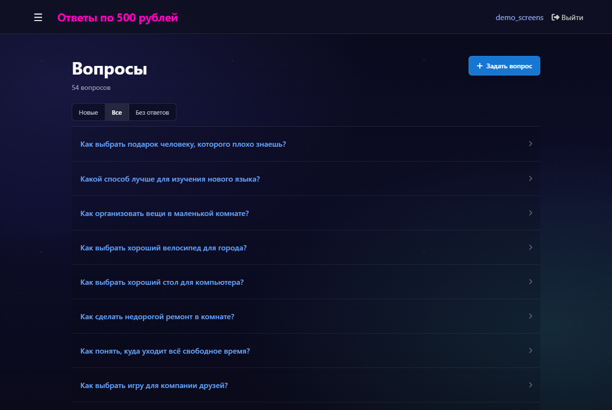
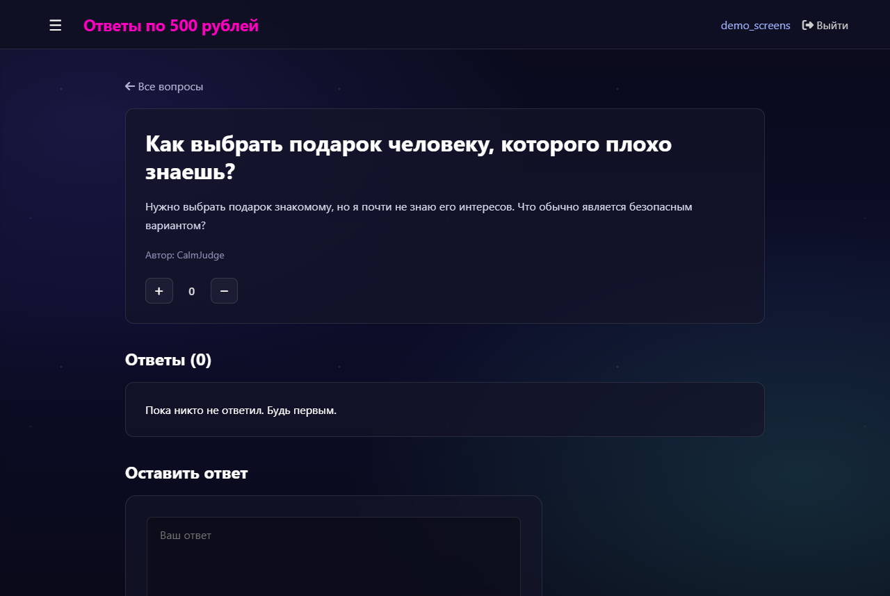
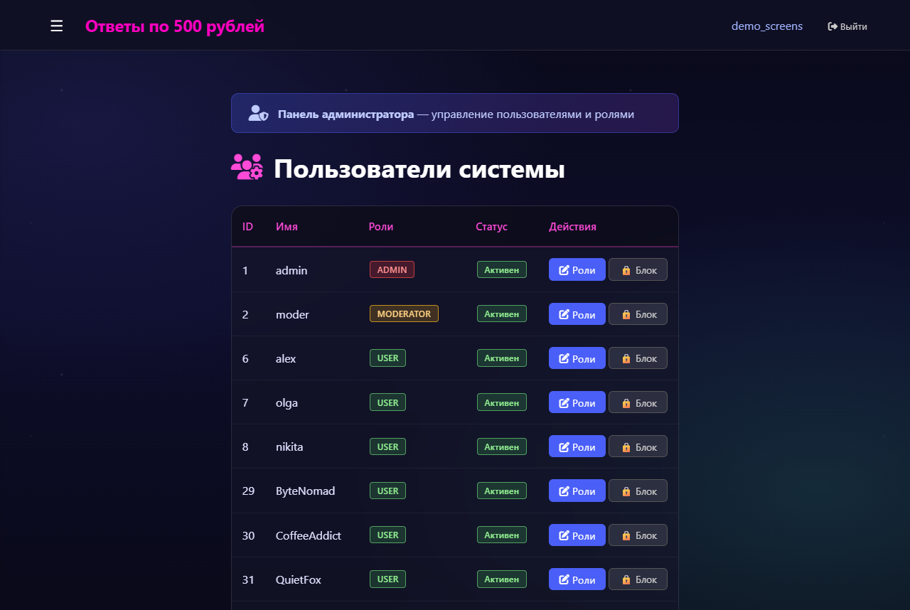
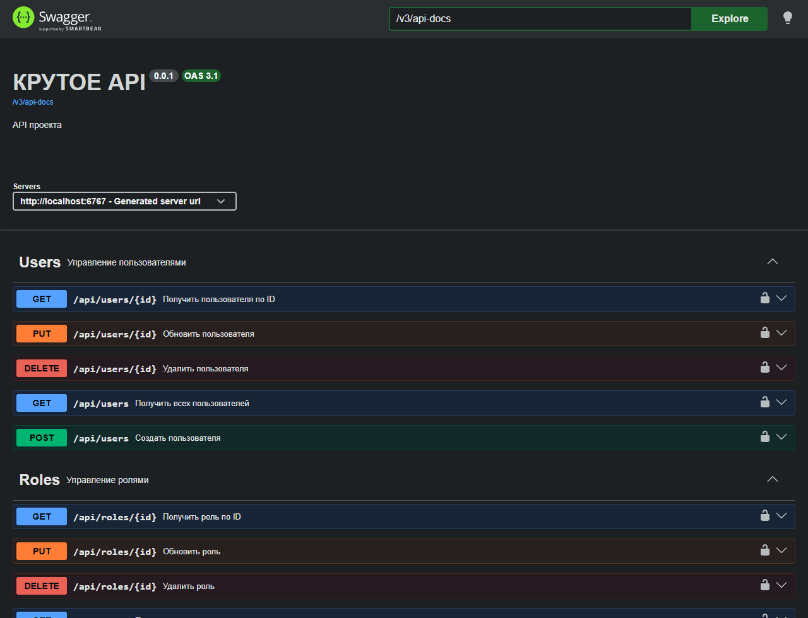

# qa-forum-spring

Форум вопросов и ответов в стиле Stack Overflow · *Stack Overflow-style Q&A forum*

`Java 17` `Spring Boot` `Spring Security` `Spring Data JPA` `Thymeleaf` `PostgreSQL` `OpenAPI`

| Лента вопросов · *Feed* | Вопрос · *Question* |
|---|---|
|  |  |
| **Админ-панель · *Admin panel*** | **Swagger UI** |
|  |  |

## Что сделано
- **Вопросы и ответы:** задать вопрос, ответить, комментарии, теги у вопросов
- **Главная лента** с фильтрами: новые (последние 10), все, без ответа
- **Поиск** вопросов по ключевому слову
- **Голосование** за вопрос: 👍 или 👎. Повторное нажатие отменяет голос, противоположное меняет его
- **Аутентификация** на Spring Security: регистрация, вход через форму, пароли хешируются BCrypt
- **Роли** `USER`, `MODERATOR`, `ADMIN` с разграничением доступа к маршрутам и своя страница «доступ запрещён»
- **Админ-панель:** редактирование ролей пользователя, блокировка и разблокировка с указанием причины. Заблокированный пользователь видит причину при попытке войти
- **REST API** `/api/*` для всех сущностей (questions, answers, comments, tags, question-tags, votes, users, roles), документация в Swagger UI
- **Слоистая архитектура:** controller → service (interface + impl) → repository (Spring Data JPA), `@Transactional` в сервисах
- **Валидация** форм (`@Valid`, `@NotBlank`, `@Size` и др.) и глобальный обработчик ошибок

## Структура
```
src/main/java/org/example/pr4/
├── config/        # WebSecurityConfig (правила доступа, логин, BCrypt), OpenApiConfig, GlobalModelAttributes
├── controller/    # MVC-контроллеры страниц + *ApiController для REST, AdminController, GlobalExceptionHandler
├── model/         # JPA-сущности: вопросы, ответы, комментарии, теги, голоса, пользователи, роли
├── repository/    # Spring Data JPA репозитории
├── security/      # AppUserDetailsService, обработчик неудачного входа (показывает причину блокировки)
└── service/       # интерфейсы сервисов и реализации в impl/
src/main/resources/
├── templates/     # Thymeleaf-страницы (лента, вопрос, логин, регистрация, admin/…)
├── static/        # стили и картинки
└── application.properties
```

## Запуск
1. Создай БД `qa_db` в PostgreSQL.
2. Задай переменные окружения `DB_USER` и `DB_PASSWORD` (по умолчанию `postgres` / `postgres`).
3. Запусти:
   ```bash
   ./mvnw spring-boot:run
   ```
4. Сайт: http://localhost:6767, Swagger UI: http://localhost:6767/swagger-ui.html

---

## English

A Stack Overflow-style Q&A forum built with Spring Boot.

### Features
- **Questions & answers** with comments and tags
- **Home feed** filters: newest (last 10), all, unanswered
- **Keyword search** for questions
- **Voting** on questions: 👍 / 👎; clicking the same vote again removes it, the opposite one switches it
- **Authentication** with Spring Security: sign-up, form login, BCrypt-hashed passwords
- **Roles** `USER`, `MODERATOR`, `ADMIN` with route-level access rules and a custom access-denied page
- **Admin panel**: edit user roles, block/unblock users with a reason; a blocked user sees the reason when trying to log in
- **REST API** under `/api/*` for every entity, documented with Swagger UI
- **Layered architecture**: controller → service (interface + impl) → Spring Data JPA repository, `@Transactional` services
- **Form validation** (`@Valid`, `@NotBlank`, `@Size`, …) and a global exception handler

### Structure
```
config/      security rules, OpenAPI, global model attributes
controller/  MVC page controllers, REST *ApiControllers, admin, exception handler
model/       JPA entities
repository/  Spring Data JPA repositories
security/    user details service, login failure handler
service/     service interfaces + impl/
resources/   Thymeleaf templates, static files, application.properties
```

### Run
1. Create the `qa_db` PostgreSQL database.
2. Set `DB_USER` / `DB_PASSWORD` (default `postgres` / `postgres`).
3. `./mvnw spring-boot:run`
4. Site: http://localhost:6767, Swagger UI: http://localhost:6767/swagger-ui.html
